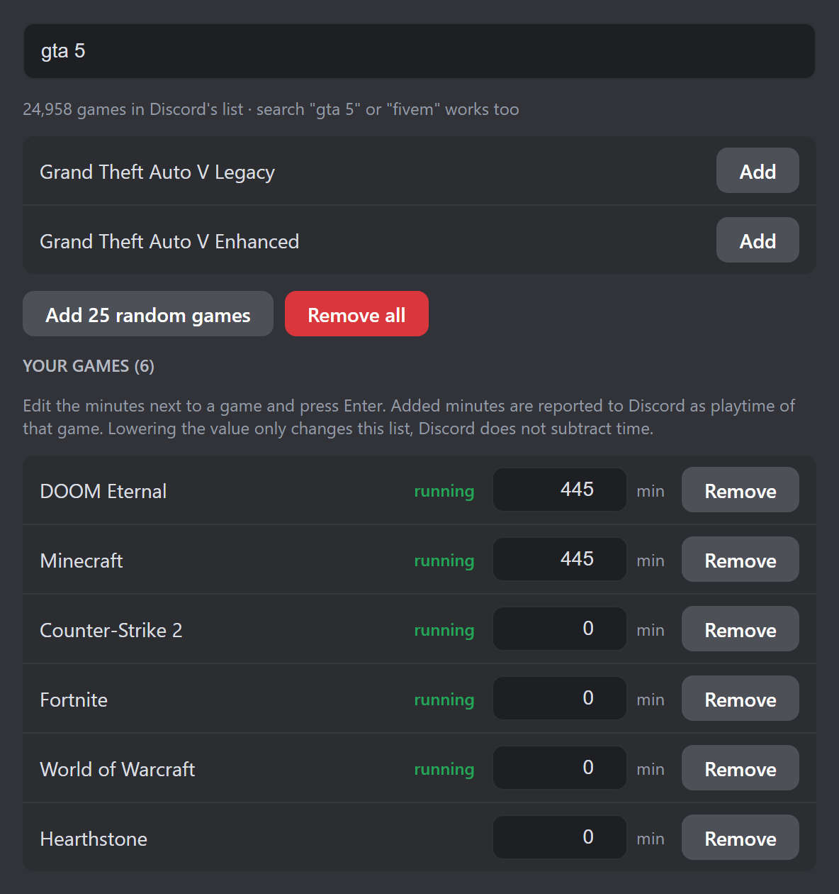

# MultiGamePlaytime

A BetterDiscord plugin that lets Discord see several games running at the same time. Discord counts playtime for every game it detects, so your playtime and the number of games you played grow faster for the Game Time and Game Variety profile badges.

It runs inside your Discord app and never reads or sends your account token. Other tools for these badges ask you to paste your token into a script, which gives that script full access to your account.

## How it works

The Discord desktop app keeps a list of the games running on your PC and reports playtime for each of them every 5 minutes. The plugin adds games from Discord's own game list to that list, so Discord reports them like games you started yourself. Playtime is real time: ten games running for one hour count as ten hours.

You can also edit the minutes of every game. When you raise the value, the plugin reports the added minutes through Discord's own playtime report, as one session of that game. Lowering the value only changes the plugin's list, because Discord does not subtract time. Whether Discord accepts large values for the badges is not confirmed.

## Features

- Search Discord's list of detectable games and add them, or add 25 random games at once
- Short searches work: "gta 5", "gta 6", "cs 2" or "cod"
- FiveM as its own entry; Discord counts its playtime as Grand Theft Auto V Legacy, like when you really play FiveM
- Games Discord knows without a PC version, like Grand Theft Auto VI, can be added too. They show on your profile, but may not count for the badges
- Choose how many games run at the same time: 1, 5, 10, 25 or all (up to 50)
- Switch to the next games of your list every 10, 30 or 60 minutes, so more different games count for Game Variety
- Show the first game as "Playing" on your profile, or hide it; playtime counts either way
- See which games are running and how long each one ran
- Edit the minutes of every game; added minutes are reported to Discord
- Statistics: total simulated time and number of games played, with a reset button
- Keeps running after a Discord restart
- English and German, follows your Discord language

## Before you use it

- Turn on "Use data to personalize my Discord experience" in User Settings → Data & Privacy. Without it, Discord does not count progress for these badges.
- Badge progress shows up after one to two days, not right away.
- Simulating games breaks Discord's Terms of Service. Discord can restrict accounts that do it. Use it at your own risk.
- It only works in the Discord desktop app, because only the desktop app detects games.

## Installation

1. Download [MultiGamePlaytime.plugin.js](https://github.com/uwemanfred64-png/MultiGamePlaytime/releases/latest/download/MultiGamePlaytime.plugin.js) from the latest release
2. Put it into your BetterDiscord plugins folder (User Settings → Plugins → Open Plugins Folder)
3. Enable it in User Settings → Plugins, open its settings, add games and turn on "Simulate games"

## Privacy

The plugin downloads Discord's public list of detectable games from cdn.discordapp.com when you open its settings. It sends no data to anyone except Discord itself, and only the playtime reports described above. Your game list and statistics are stored in your BetterDiscord folder.

## License

[MIT](LICENSE)
